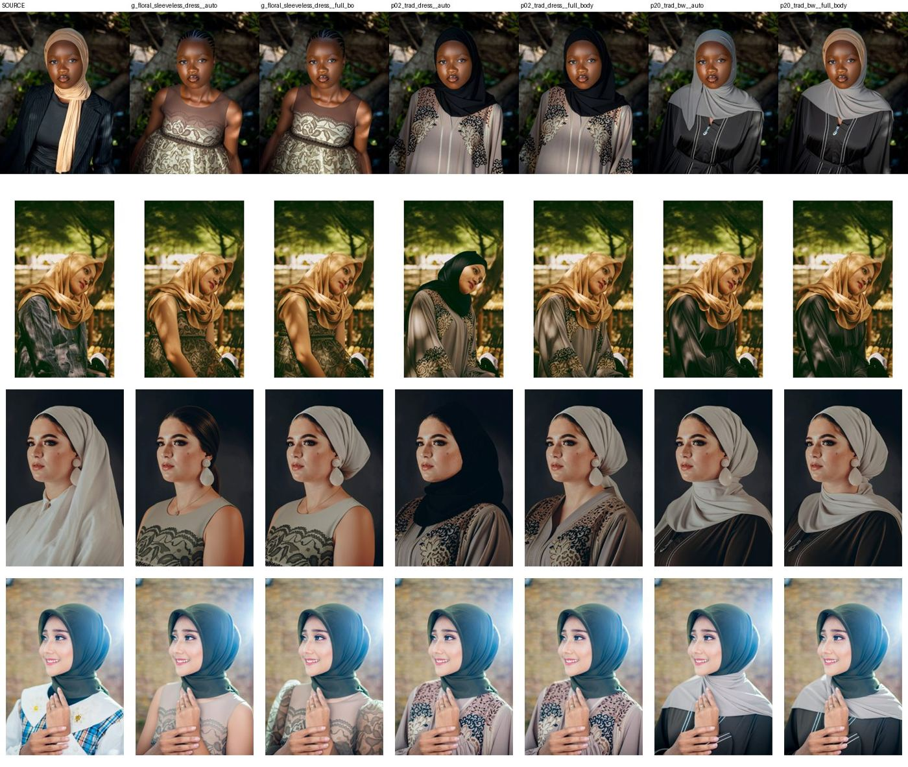
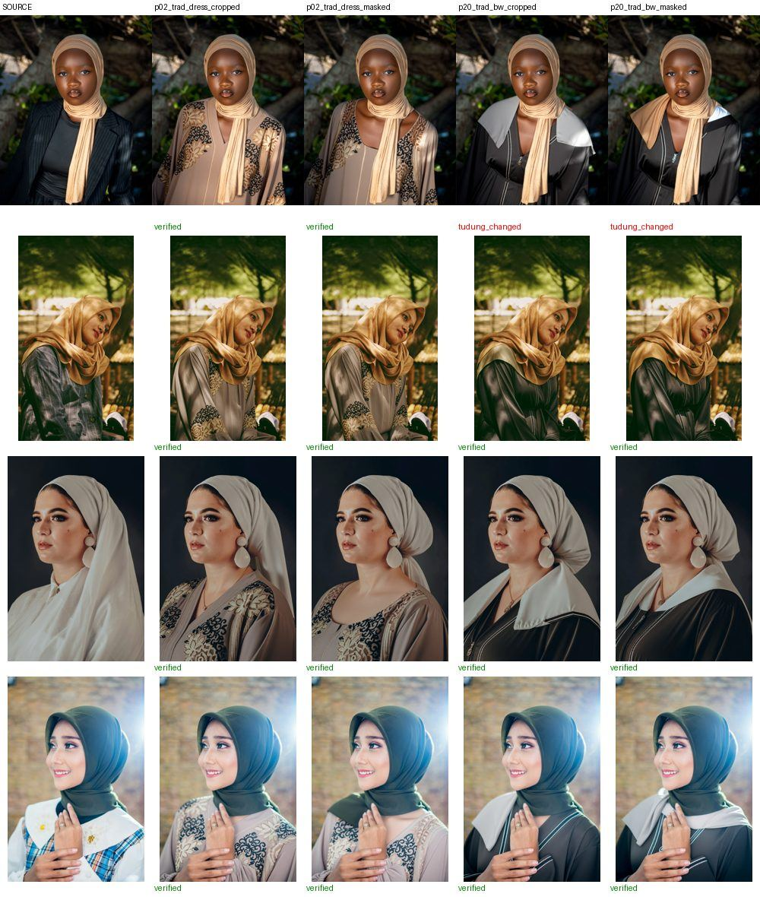

# Does YouCam try-on keep a hijab? A small measured study

23 October 2026 · YouCam API `cloth-v4` and `scarf` · 60 tasks · 116 units

## Setup

- **Shoppers:** four hijab-wearing models from free-licence stock photos, roughly Fitzpatrick III–VI, with different tudung styles (bawal, loose shawl, instant shawl with scarf, fitted).
- **Garments:** two abaya photos worn by hijab-wearing models, and one sleeveless lace dress shown as a product shot.
- **Conditions:** garment categories `auto`, `full_body` and `upper_body`; reference model's head masked (painted out, or cropped below the chin); Scarf VTO run directly on the shopper photo.
- **Grading:** each render was graded by eye as *kept*, *tudung changed* or *hair exposed*. The on-device integrity check (`docs/study/integrity.py`, ported to `lib/vision.ts`) was then scored against those grades.

## Results

| Condition | Renders | Outcome |
|---|---|---|
| Abaya reference, `auto` / `full_body` | 16 | hair never exposed; shopper's own tudung kept in **6** (the model's tudung was often copied) |
| Abaya reference, `upper_body` | 8 | tudung swapped in **7** |
| Abaya reference with model's head masked, `full_body` | 16 | shopper's own tudung kept in **16**; one reference leaves a small grey collar from the model's long hijab drape |
| Sleeveless dress (all categories) | 12 | hijab removed, hair showing in **5**; bare arms in the rest |
| Scarf VTO on shopper photo | 8 | 6 generated a new full-body street scene; 2 failed with `error_no_face` on a tilted head |

All `cloth-v4` tasks succeeded, at a median of 11.7 s (range 11.4–19.0 s) and 2 units each.

## Integrity check accuracy (36 hand-graded renders)

| Signal | Caught | False alarms |
|---|---|---|
| Hair exposed (new hair, or the head covering largely gone: overlap < 0.45) | 5 / 5 | 0 |
| Tudung changed (overlap < 0.70, or CIEDE2000 colour shift > 10) | 11 / 18 | 0 |
| Extra body skin below the chin | sleeveless renders +23% to +43%, modest renders ≤ +5% | threshold set at +12% |

The misses are subtle same-tone overlays, such as a light grey drape added over a white tudung. Thresholds were tuned on these same renders, so this is a first measurement, not a benchmark; the next step is a held-out set with more skin tones and tudung styles.

## What changed in the product because of this

- The reference model's head is masked before every render.
- The garment category is `full_body` for dresses, abaya and kurung, and `auto` for tops; `upper_body` is never used.
- Scarf VTO is not used.
- Renders with hair showing are hidden. Skin-exposed renders are shown with a layering suggestion.
